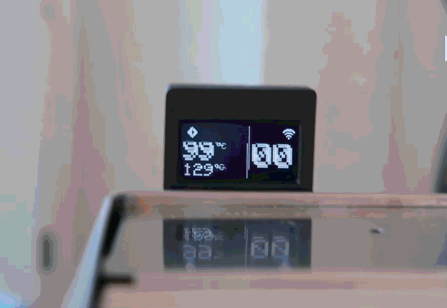

# mara x shot timer



## features

- show machine boiler and brew water temps
- shows machine heating mode
- auto start of timer
- milliseconds timer when brewing
- showing of last shot time
- standby mode for display (to avoid oled burnin and stuff...)
  - sleep countdown starts when machine stops sending messages
- OTA updates
- case for sticking to back of machine
- **MQTT integration** for home automation (see below for details)
- **BLE scale integration** (POC): live weight + scale timer from a BOOKOO
  Themis scale via Bluetooth (see below for details)
- screen‑saver: automatic dimming, sleep and daily white‑flash to reduce OLED burn‑in

## MQTT Integration

The timer can publish state to an MQTT broker using the ArduinoHA library.
This is optional – if no broker address is provided, the sketch runs standalone.

To enable it, create a `secrets.h` file (see "initial setup" below) and add
these defines:

```c
#define MQTT_BROKER_ADDR "192.168.1.100"  // or hostname
#define MQTT_BROKER_PORT 1883
#define MQTT_USERNAME "user"            // optional
#define MQTT_PASSWORD "pass"            // optional
```

When connected the device exposes several sensors:

- `temperature` – boiler/brew water temperature (string)
- `steamTemp` – steam wand temperature (string)
- `lastShotTime` – duration of the most recent shot in seconds
- `pumpSensor` – `"ON"`/`"OFF"` on pump transitions
- `heating` – `"ON"`/`"OFF"` heating element state
- `heatingBoost` – indicates boost heating mode
- `machineMode` – `"C"`, `"S"` or `"X"` for coffee/steam/unknown
- `sleep` – `"OFF"` when display is awake, `"ON"` when asleep

Sensors update once per second and the device uses its unique ID
(e.g. `esp-mara-timer`) so they can be integrated easily with Home
Assistant or any other MQTT consumer.

For more info on the data format see the comments in `timer.ino`.

## BOOKOO scale integration (proof of concept)

The timer can connect over Bluetooth Low Energy to a BOOKOO Themis Ultra
espresso scale (protocol: https://github.com/BooKooCode/OpenSource) and
shows the live weight and the scale's own timer on the bottom edge of the
display. The values show `null` / `--:--` placeholders until data arrives,
so an absent value is visibly different from "not drawn at all".

- enabled by default; set `BOOKOO_ENABLED` to `0` in `timer/bookooScale.h`
  to build without it (and fit the default partition scheme again)
- no extra library needed - BLE support ships with the esp32 arduino core (4.x)

### flash size note

enabling BLE grows the firmware past the default partition scheme's app
size. compile and upload with the `min_spiffs` partition scheme:

```sh
arduino-cli compile -b esp32:esp32:esp32c3:PartitionScheme=min_spiffs timer/
arduino-cli upload -b esp32:esp32:esp32c3:PartitionScheme=min_spiffs -p COM3 timer/
```

a device that still runs the default partition scheme must be flashed with
the new scheme **once via usb** - partition tables can't be changed over
OTA. afterwards OTA updates work normally (min_spiffs has two ~1.9MB app
slots).

## Screen saver & burn‑in protection

The firmware includes several features designed to slow OLED aging:

- display dims to very low contrast 10 s after a wake event
- screen turns fully off after a configurable idle period (default 15 min)
- pump activity or mode changes immediately restore full brightness
- on cold boot the display flashes white for about 5 s to equalize wear
- at midnight the display also flashes white for a few minutes to even out
  ageing (this requires a working Wi‑Fi/NTP time; offline units will skip the
  midnight flash)

## notes

- fork and rewrite of https://github.com/alexrus/marax_timer
- written for ESP32C3

## initial setup

### 1. install arduino IDE (2.x)

### 2. install ESP32 board support

- add the espressif board index: **file → preferences → additional boards
  manager URLs** → add
  `https://espressif.github.io/arduino-esp32/package_esp32_index.json`
- boards manager → install **"esp32" by Espressif Systems**, **version 4.x**
- select board **"ESP32C3 Dev Module"**
- ArduinoOTA is included in the esp32 core, no separate install needed

### 3. install libraries (tools → manage libraries)

install the following libraries from the library manager (latest version is
fine for all of them, except where noted):

| library (exact name)  | author               | notes                                  |
| --------------------- | -------------------- | -------------------------------------- |
| Adafruit GFX Library  | Adafruit             | display graphics core                  |
| Adafruit SH110X       | Adafruit             | SH1106 OLED driver                     |
| Adafruit SSD1306      | Adafruit             | accept "install dependencies" (BusIO)  |
| EspSoftwareSerial     | Dirk Kaar / P. Lerup | **v8.1.0 or newer** (ESP32-C3 support) |
| PubSubClient          | Nick O'Leary         | MQTT client (dependency of ArduinoHA)  |
| BLE                   | Espressif (bundled)  | ships with esp32 core, nothing to install |

two more libraries must be installed manually from github (run in the
`libraries` folder of your arduino sketchbook):

```powershell
# Timer (scheduler for the periodic display/MQTT callbacks)
# NOTE: the "Timer" library in the library manager is a DIFFERENT one, use this:
git clone --depth 1 --branch v1.3 https://github.com/JChristensen/Timer.git Timer

# ArduinoHA (MQTT / home assistant integration), not in the library manager:
git clone --depth 1 --branch 2.1.0 https://github.com/dawidchyrzynski/arduino-home-assistant.git ArduinoHA
```

(alternatively download the release zips and extract them there)

### 4. create `timer/secrets.h`

copy `timer/secrets.h.sample` to `timer/secrets.h` and fill in your values:

```C++
#define WIFI_SSID "your wifi name/ssid"
#define WIFI_PW "your wifi password"
#define OTA_PW "your password for OTA updates"
```

for MQTT support also set the `MQTT_*` defines (set `MQTT_BROKER_ADDR` to
`IPAddress(0, 0, 0, 0)` to disable MQTT - see "MQTT Integration" above).

> `secrets.h` is git-ignored, so it must be recreated on every new
> machine/clone. alternatively you can add your credentials directly in
> timer.ino but be sure to not commit them to git.

### 5. upload

- set **tools → partition scheme → "Minimal SPIFFS (1.9MB APP with
  OTA/190KB SPIFFS)"** (required for the BLE scale build)
- the first upload to the devboard needs to happen via usb
  build and upload the sketch - see [docs/FLASHING.md](docs/FLASHING.md)
  for a step-by-step guide
- afterwards updates work over-the-air (OTA)
- connect

### alternative: arduino-cli

instead of the arduino IDE you can use `arduino-cli`:

```sh
# install the esp32 core (4.x)
arduino-cli core update-index --additional-urls https://espressif.github.io/arduino-esp32/package_esp32_index.json
arduino-cli core install esp32:esp32 --additional-urls https://espressif.github.io/arduino-esp32/package_esp32_index.json

# install the libraries (Timer + ArduinoHA must be installed manually, see above)
arduino-cli lib install "Adafruit GFX Library" "Adafruit SH110X" "Adafruit SSD1306" EspSoftwareSerial PubSubClient

# compile and upload (replace COM3 with your port)
arduino-cli compile -b esp32:esp32:esp32c3 timer/
arduino-cli upload -b esp32:esp32:esp32c3 -p COM3 timer/
```

you still need to create `timer/secrets.h` as described above.

## Hardware

The following hardware is needed:

- ESP32C3 (or similar others)
  - can be adjusted for other boards by changing pins
- 1.3" OLED display (sh1106)
  - or other similar screens but library needs to be adjusted
- Reed sensor
  - Normally closed and normally opened works
- Wires
- 3D printed case (see 3dmodels folder for files or design your own)

## wiring

- TODO
